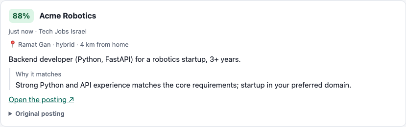

<p align="center"></p>

# Job Agent

**Stop scrolling through WhatsApp job groups.** Job Agent reads the job groups you choose, has an
AI compare each posting with your CV (or a short description of the job you want), and sends you
only the jobs that fit, with a score and a one-line reason.

- Runs on your own computer. With the default local AI, your CV and messages never leave it.
- Set it up once in a simple web page: scan a QR code, tick your groups, upload your CV.
- Matches arrive in your own WhatsApp chat (or a group, Telegram, email, a Google Sheet or a file).
- You decide what counts: which skills matter most, deal-breakers, and how far from home you'll travel.



---

## Contents

1. [What you need](#what-you-need)
2. [Install (one time, about 20 minutes)](#install-one-time-about-20-minutes)
3. [First-time setup in the web page](#first-time-setup-in-the-web-page)
4. [Everyday use](#everyday-use)
5. [Settings explained](#settings-explained)
6. [Choosing the AI](#choosing-the-ai)
7. [Other places to get your matches](#other-places-to-get-your-matches)
8. [Privacy](#privacy)
9. [Problems and fixes](#problems-and-fixes)
10. [For developers](#for-developers)

---

## What you need

- **A computer** (Mac, Windows or Linux) that is on while you want jobs checked. Jobs posted while
  it is off are not read later.
- **Your phone with WhatsApp**, to link Job Agent the same way you link WhatsApp Web.
- **Docker Desktop** (free): it runs Job Agent in a sealed box so you don't have to install
  anything else by hand. Download it from <https://www.docker.com/products/docker-desktop/>.
- **An AI model**, one of:
  - **Ollama** (free, runs on your computer, private). Needs a computer with at least 16 GB of
    memory, see [Which model for my computer?](#which-model-for-my-computer).
    Download it from <https://ollama.com>.
  - **A paid AI service** such as OpenAI or Gemini, for computers with less memory.
    See [Choosing the AI](#choosing-the-ai).
- **Your CV as a PDF**, or a few sentences describing the job you're looking for.

> **About the Terminal.** A few install steps ask you to type a command. On a Mac, open the
> **Terminal** app (press ⌘ Space, type *Terminal*, press Enter). On Windows, open **PowerShell**
> from the Start menu. Type or paste the command and press Enter. That's all you need to know.

---

## Install (one time, about 20 minutes)

### 1. Install Docker Desktop and open it

Install it like any other app and **open it**. Wait until it says Docker is running.
Leave it running: Job Agent only works while Docker Desktop is open.

### 2. Install Ollama and download a model

*(Skip this step if you'll use a paid AI service.)*

Install Ollama and open it. Then, in the Terminal, run:

```
ollama pull gemma4:e2b
```

This downloads the AI model (about 5 GB, so it can take a while). If your computer has 24 GB of
memory or more, use the better `gemma4:12b` instead (`ollama pull gemma4:12b`) and choose it
later in the settings. See [Which model for my computer?](#which-model-for-my-computer).

### 3. Download Job Agent

Go to <https://github.com/orisuchy/WhatsApp-Jobs-Agent>, click the green **Code** button →
**Download ZIP**, and unzip it somewhere easy to find, for example your Documents folder.
**Rename the unzipped folder to `job-agent`**: the next steps use that name.

(If you use git: `git clone https://github.com/orisuchy/WhatsApp-Jobs-Agent.git job-agent`.)

### 4. Create your settings file

Inside the `job-agent` folder there is a file called `.env.example`. Make a copy of it named
exactly `.env` (with the dot, and no `.example`). The quickest way is the Terminal:

- **Mac / Linux:** `cd ~/Documents/job-agent` and then `cp .env.example .env`
- **Windows (PowerShell):** `cd ~\Documents\job-agent` and then `copy .env.example .env`

(Change the folder path if you unzipped it somewhere else.)

You don't need to edit this file: everything can be set in the web page. If you downloaded a
different model in step 2, you can change it in the web page too.

> Files starting with a dot are hidden on Mac. In Finder, press **⌘ Shift .** to show them.

### 5. Start Job Agent

In the Terminal, still inside the `job-agent` folder, run:

```
docker compose up -d --build
```

The first time takes a few minutes while it prepares everything. When it's done you're back at
the prompt. Job Agent now runs in the background, and it starts again by itself whenever Docker
Desktop starts.

---

## First-time setup in the web page

Open **<http://localhost:8000>** in your browser. This page only works on your own computer.

1. **Connect WhatsApp.** A QR code appears on the **Dashboard**. On your phone open WhatsApp →
   **Settings** → **Linked devices** → **Link a device**, and scan it. After a few seconds the page
   shows that WhatsApp is connected. You stay linked, even after a restart.
2. **Add your profile.** Open the **Profile** tab and upload your CV (PDF), write a short
   description of the job you want, or both:
   - **CV only:** jobs are matched to your experience.
   - **Description only:** good if you're changing careers or don't have a CV handy.
     For example: *"Junior data analyst, Excel and SQL, Tel Aviv area or remote, no shifts."*
   - **Both:** your CV is the background and the description is what you're aiming for.
3. **Pick your job groups.** Open **Settings** → **Groups to watch**, search, and tick the WhatsApp
   groups where jobs are posted. Job Agent only reads them; it never posts there.
4. **Choose where matches go.** In **Where matches go**, keep **WhatsApp** and pick
   **Me (Message yourself)** to get matches in your own chat, or pick a group.
5. Click **Save settings** at the bottom.

Done. From now on, every new job posted in those groups is checked, and good matches are sent to
you. Matches also appear on the **Dashboard**, newest first.

---

## Everyday use

- **See your matches:** open <http://localhost:8000>. Each card shows the score, company, a short
  summary, why it matches, the group, and the original posting.
- **Keep track of a job:** on its card, **Add note** (who to call, when you applied…; saved
  automatically), **Hide** it (find it again under *Hidden jobs*), or **Remove…** it. When removing,
  you choose whether the same posting should show up again if someone reposts it. Hiding or
  removing asks "Not for you? Why" (optional): your answer is added to your scoring preferences,
  so similar postings score lower from now on.
- **Star a job:** click the ☆ on its card. Starred jobs stay at the top of the list.
- **Track your application:** pick *Interested*, *Applied*, *Interview*, *Offer* or *Rejected* on a card, and use the status filter above the list to see only those.
- **Get a reminder:** on a card, pick a date and time under **Remind me**. When it comes, Job Agent
  messages you once on WhatsApp (your target chat) and on Telegram or email if you turned those on.
  Click **Clear reminder** to cancel. The computer must be on (and WhatsApp connected) at that time;
  if it isn't, the reminder arrives as soon as it is.
- **Export your list:** click **Export CSV** next to the job count to download all your matches, with your notes, statuses and stars, as a file you can open in Excel or Google Sheets.
- **Stop Job Agent:** in the Terminal, inside the `job-agent` folder, run `docker compose stop`.
  Or simply quit Docker Desktop.
- **Start it again:** open Docker Desktop (it starts by itself), or run `docker compose up -d`.
- **Update to a newer version:** download the new version (step 3), copy your `.env` file and
  `data` folder into it, and run `docker compose up -d --build`.
- **Unlink WhatsApp:** on your phone, WhatsApp → Linked devices → tap Job Agent → Log out.

Your settings, profile and matches are kept in the `data` folder. Back it up if you care about them.

---

## Settings explained

Everything below is in the **Settings** tab. Changes apply right away when you click
**Save settings**; no restart is needed.

| Setting | What it does |
|---|---|
| **Groups to watch** | The WhatsApp groups Job Agent reads. |
| **Minimum score** | Jobs scoring at least this (0–100) count as a match. Default 70. Lower it if you get too few matches, raise it if you get too many. |
| **Language of summaries** | The language of the summary and reason, for example English or Hebrew. |
| **Auto-hide after (days)** | Optional. Jobs older than this move to **Hidden jobs**, unless you starred them or gave them a status. Click **Unhide** to keep one for good. Empty = never hide. |
| **Scoring preferences** | What matters to you (see below). |
| **Location** | Your home and how far you're willing to travel (see below). |
| **AI model** | Which AI checks the postings. See [Choosing the AI](#choosing-the-ai). |
| **Where matches go** | WhatsApp, a file, Telegram, email or Google Sheets. You can pick several. |

### Scoring preferences

Each job is judged on four things. You decide how much each one counts:

- **Role & seniority:** is it the right kind of job, at the right level?
- **Hard skills:** does it ask for skills you have?
- **Domain experience:** is it in a field you know (e.g. fintech, healthcare)?
- **Overall fit:** everything else.

The numbers are relative. 30/30/30/10 (the default) means the first three count equally and
"overall fit" counts a little. Set one to 0 to ignore it. The page shows the resulting percentages.

**Automatic rejects:** tick the deal-breakers that should sink a job straight away (score 30 or
lower): something the job requires that you clearly lack, a completely different kind of role, or
a big seniority gap (e.g. junior vs. team lead).

**Anything else that matters to you:** write it in plain words, in any language. For example:
*"No recruitment agencies. Prefer startups. No night shifts."*
When you hide or remove a job and say why, that reason is added here as a line starting with
*Not for me:*. You can edit or delete these lines like any other text.

### Location

Write your **Home** (a city is enough) and a **Maximum distance** in km. Jobs that need you in the
office (on-site or hybrid) and are farther than that are rejected. Remote jobs, and jobs that
don't say where they are, are never rejected for distance. Leave the distance empty to just see
"N km from home" on each match without rejecting anything.

The distance is a straight line on the map, not driving time, so leave some margin.

---

## Choosing the AI

| | Local (Ollama) | Paid service (OpenAI, Gemini, …) |
|---|---|---|
| **Cost** | Free | Pay per use; usually cheap with a small model (check the provider's prices) |
| **Privacy** | Nothing leaves your computer | Postings and your CV are sent to that company |
| **Needs** | 16 GB of memory or more (see below) | An account and an API key |
| **Speed** | Depends on your computer | Fast |

Only messages that look like job postings are sent to the AI, so normal chatter costs nothing.

### Which model for my computer?

First check how much memory (RAM) your computer has: on a Mac, Apple menu → **About This Mac**
(the "Memory" line); on Windows, **Settings → System → About** ("Installed RAM").

| Your computer's memory | Use |
|---|---|
| Less than 16 GB | A paid AI service: a local model would leave too little memory for everything else |
| 16 GB | `gemma4:e2b` (the default) |
| 24 GB or more | `gemma4:12b`: noticeably better matching |

Why: Job Agent itself (Docker and the hidden browser that runs WhatsApp) plus your system and
browser use about 6 GB. `gemma4:e2b` needs about 5–6 GB more while it works, `gemma4:12b`
about 8–9 GB.

Speed: on Apple Silicon Macs (M1 and newer) and PCs with a recent graphics card, a posting takes
seconds. On other computers it works, but each posting can take a minute or more.

If your computer gets slow or a model keeps timing out, switch to the smaller model or a paid service.

**To use a paid service:** create an API key on the provider's website, then in
**Settings → AI model** set **Provider** to *OpenAI-compatible API*, and fill in **Server
address**, **Model** and **API key** from this table:

| Provider | Server address | Model example |
|---|---|---|
| OpenAI | `https://api.openai.com/v1` | `gpt-4o-mini` |
| Google Gemini | `https://generativelanguage.googleapis.com/v1beta/openai/` | `gemini-2.0-flash` |
| Groq | `https://api.groq.com/openai/v1` | `llama-3.3-70b-versatile` |
| OpenRouter | `https://openrouter.ai/api/v1` | `meta-llama/llama-3.3-70b-instruct` |
| Anthropic | `https://api.anthropic.com/v1/` | a Claude model id |
| LM Studio (local) | `http://host.docker.internal:1234/v1` | the model you loaded |

Ollama is the tested option; the others use the same standard connection and should work.

**"Too big for this model" warning:** the AI model section estimates whether your CV,
description and a posting fit in what the model can read at once. If it warns you, follow its
advice: with Ollama this usually means raising **Context size**, or shortening your job
description.

---

## Other places to get your matches

In **Settings → Where matches go** you can tick several destinations. Ticking one shows its
fields; fill them in and click **Save settings**. If a destination isn't set up correctly, it is
skipped and the others still work.

<details>
<summary><b>A file on your computer (or Google Drive)</b></summary>

Tick **Local file**. Every match is added to `data/outputs/matches.md` (easy to read) and
`matches.jsonl` (for spreadsheets or scripts), inside the job-agent folder.

**To get it in Google Drive:** install [Google Drive for Desktop](https://www.google.com/drive/download/)
and create a folder in your Drive (e.g. `job-matches`). Then open `docker-compose.yml` in a text
editor and change the `python-backend` part so it looks like this, using your folder's real path:

```yaml
    environment:
      DATA_DIR: /data
      OUTPUT_DIR: /outputs
    volumes:
      - ./data:/data
      - "/Users/you/Google Drive/My Drive/job-matches:/outputs"
```

Then run `docker compose up -d`.
</details>

<details>
<summary><b>Telegram</b></summary>

1. In Telegram, open **@BotFather**, send `/newbot` and follow the steps. It gives you a
   **token** (a long code). Paste it into **Bot token**.
2. Message **@userinfobot**: it replies with your id. Paste it into **Chat id**.
3. Open a chat with your new bot and send it any message (bots can't write to you first).
4. Click **Save settings**.

*To send to a Telegram group instead:* add the bot to the group, send a message there, open
`https://api.telegram.org/bot<TOKEN>/getUpdates` in your browser (your token in place of
`<TOKEN>`), and use the number after `"chat":{"id":` (it starts with a minus sign).
</details>

<details>
<summary><b>Email (Gmail example)</b></summary>

1. Turn on **2-Step Verification** for your Google account, then create an **app password** at
   <https://myaccount.google.com/apppasswords>.
2. Tick **Email** and fill in: SMTP server `smtp.gmail.com`, port `587`, username = your Gmail
   address, password = the 16-character app password (not your normal password), and the
   From and Send to addresses.
3. Click **Save settings**.

Any other email provider works the same way with its own SMTP details.
</details>

<details>
<summary><b>Google Sheets</b></summary>

This one has the most steps.

1. In the [Google Cloud console](https://console.cloud.google.com/), create a project, then go to
   **APIs & Services → Library** and enable **Google Sheets API**.
2. Go to **IAM & Admin → Service Accounts**, create one, then **Keys → Add key → JSON**. A key
   file downloads to your computer. Keep it private: it works like a password.
3. In Job Agent, tick **Google Sheets**, click **Upload key file** and choose that file.
   The page then shows an email address ending in `.iam.gserviceaccount.com`.
4. Open your Google Sheet, click **Share**, and share it with that email address as **Editor**.
5. Back in Job Agent, paste the sheet's link (copy it from the browser's address bar) and, if you
   want, a tab name. Click **Test**: it tells you what to fix if something is wrong.
6. Click **Save settings**.

**More than one sheet:** click **+ Add another sheet**. Every match is added to all of them. A sheet
that belongs to another Google account works too: share it with the same email address (step 4).

A header row is added if the sheet is empty, then one row per match.
</details>

---

## Privacy

- **The web page** works only on your own computer. Other people on your Wi-Fi can't open it.
- **With Ollama**, your CV, job description and the postings stay on your computer.
- **With a paid AI service**, job-like postings, pages linked from them, your job description and
  your CV are sent to that service. Your CV is first sent once to be cleaned and anonymised; after
  that only the anonymised version is used.
- **Location:** if you set a home location, only place names (your city and the job's city) are
  looked up on [OpenStreetMap](https://nominatim.org/). Each place is looked up only once.
- **Matches** go only to the destinations you tick.
- **Passwords and keys** stay in the `data` folder (or your `.env` file). The web page never shows
  them again after you save them.
- Job Agent never posts in the groups it reads.

---

## Problems and fixes

**The page at localhost:8000 doesn't open.**
Make sure Docker Desktop is open and running, then run `docker compose up -d` in the job-agent folder.

**No QR code appears, or WhatsApp won't connect.**
Wait a minute: the first start is slow. Then click **Reconnect WhatsApp** on the Dashboard. If it
still fails, see the WhatsApp update note further down.

**WhatsApp shows as disconnected.**
Click **Reconnect WhatsApp**. If you logged out from your phone, a new QR code appears; scan it again.

**I'm not getting any matches.**
- Check that your groups are ticked and **Save settings** was clicked.
- Check that your CV or job description is on the **Profile** tab.
- Lower the **Minimum score** (try 60).
- Only messages that look like job postings are checked; ordinary chat is ignored on purpose.

**I'm getting too many poor matches.**
Raise the **Minimum score**, tick more **Automatic rejects**, add notes under **Anything else
that matters to you**, or try a stronger AI model.

**"Ollama unreachable" or the AI doesn't answer.**
Make sure the Ollama app is open and you downloaded the model (`ollama pull gemma4:e2b`). The
model name in **Settings → AI model** must match exactly. On Linux, Ollama must accept outside
connections: start it with `OLLAMA_HOST=0.0.0.0 ollama serve`.

**The AI is very slow / "timed out" in the logs.**
Use a smaller model, or add both of these to `.env` with bigger values, then run
`docker compose up -d`:
```
LLM_TIMEOUT_S=300
ANALYZE_TIMEOUT_MS=310000
```
(The second number must be larger than the first × 1000.)

**WhatsApp stopped working after a WhatsApp update ("Failed to initialize client").**
WhatsApp sometimes changes its web version and breaks the connection until the underlying library
is updated. Download the latest Job Agent and run `docker compose up -d --build`. Advanced: you
can pin a WhatsApp Web version that still works with `WWEBJS_WEB_VERSION=<version>` in `.env`
(versions are listed [here](https://github.com/wppconnect-team/wa-version/tree/main/html): use the
file name without `.html`).

**I want to start WhatsApp from scratch.**
Run `docker compose down -v` and then `docker compose up -d`. This unlinks WhatsApp (you scan the
QR code again) but keeps your settings, profile and matches.

**Looking at the logs** (useful when asking for help):
`docker compose logs --tail 100` shows the last 100 lines from both parts of Job Agent.

---

## For developers

### How it works

```
WhatsApp source groups
        │  (whatsapp-web.js, node_service)
        ▼
  keyword pre-filter ──► POST /analyze ──► python_service (FastAPI)
                                              │ fetches linked posting, asks the LLM
                                              ▼
                                 score ≥ MATCH_THRESHOLD? ── dedup ──► outputs:
                                 WhatsApp · file · Telegram · email · Google Sheets
```

- `node_service` holds the WhatsApp client and pushes its state (status, QR, groups) to Python.
- `python_service` owns the config, the LLM calls, dedup, outputs and the web UI (port 8000,
  published on `127.0.0.1` only, no authentication).
- Each posting is analysed once; the same job in several groups (same first URL, or same text
  ignoring case and whitespace) is delivered once. Matches are recorded in `data/matches.jsonl`.

### Configuration

Every setting is a key in `.env`; see `.env.example` for the full list with comments. Values
saved in the web UI go to `data/settings.json` and override `.env` (delete a key there to fall
back to `.env`). Secrets are never sent back to the browser.

`.env` is read inside the containers, where `./data` is mounted at `/data`, so file paths in
`.env` use `/data/...`. Use `./data/...` only when running the Python service directly on the host.

Profile files live in `data/profile/`: `cv.pdf` and/or `job_description.md` (or `.txt`). The CV is
cleaned and anonymised by the LLM once and cached in `cv_clean_text.txt`; the cache refreshes when
`cv.pdf` changes.

Useful keys not in the UI: `LLM_TIMEOUT_S` (default 170), `ANALYZE_TIMEOUT_MS` (default 180000,
must exceed the former), `LLM_THINK` (Ollama, default false), `WWEBJS_WEB_VERSION`, and
`LIST_GROUPS=1` (`docker compose run --rm -e LIST_GROUPS=1 node-whatsapp` prints group names and
JIDs, then exits). The keyword pre-filter is `JOB_KEYWORDS` in `node_service/whatsapp-agent.js`.

whatsapp-web.js is installed from upstream commit `38eb45b2`, which fixes the November 2026
WhatsApp Web break; switch back to the npm release once one includes it.

### Tests and contributing

See [CONTRIBUTING.md](CONTRIBUTING.md) for running the Python and Node test suites. Licensed under
the [MIT License](LICENSE).
